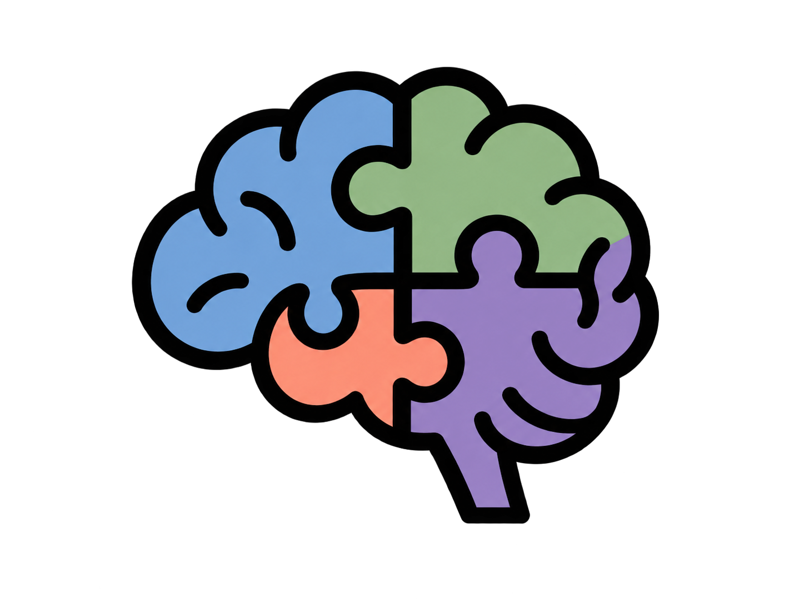

<div align="center">



# NeuroVita

**Agendamento de consultas e acompanhamento de pacientes para clínicas de psicologia e psiquiatria.**


[Sobre](#-sobre-o-projeto) ·
[Funcionalidades](#-funcionalidades-por-perfil) ·
[Como rodar](#-como-rodar) ·
[Contas de teste](#-contas-de-teste) ·
[Back-end](#-ligando-ao-back-end)

</div>

---

## 📖 Sobre o projeto

O **NeuroVita** é um sistema web para clínicas que atendem pacientes de neurodesenvolvimento (como TEA e TDAH). Ele organiza a agenda, o cadastro de pacientes, profissionais e secretárias e o prontuário, com um painel diferente para cada tipo de usuário (secretária e administrador).

Este repositório contém o **front-end**, desenvolvido em Angular e fiel ao protótipo do Figma da equipe de design. Hoje ele funciona de ponta a ponta com **dados de teste em memória**, prontos para serem trocados por chamadas à API quando o back-end estiver pronto.

> ⚠️ **Todos os nomes, CPFs, telefones e e-mails do projeto são fictícios.**

## ✨ Funcionalidades por perfil

O sistema tem **2 perfis**. As telas são parecidas, mas o menu, os botões e as permissões mudam conforme quem entrou.

| Perfil | O que faz |
| --- | --- |
| 🗂️ **Secretária** | Acompanha os números do dia. **Cadastra, edita e exclui pacientes**, abre o **prontuário** (botão "Ver prontuário"), **agenda consultas** vendo só os horários livres e, na agenda, **confirma, remarca ou cancela** consultas. |
| 🛠️ **Administrador** | Visão geral da clínica. Consulta pacientes e abre o **prontuário** (botão "Ver prontuário"). **Cadastra, edita, inativa e exclui profissionais** (com dias, horários e tipo de atendimento) e **secretárias**, e acompanha a agenda. |

### Destaques

- **Disponibilidade do profissional valendo de verdade:** ao agendar, só aparecem os horários dos dias, faixas e tipo de atendimento (online ou presencial) que o profissional atende, sem choque com outras consultas.
- **Prontuário completo** para secretária e administrador: dados pessoais, responsável, histórico e as 4 seções acolhimento, documentações, rastreio e devolutiva (galerias de documentos por grupo). Tem **editor de texto** (estilos, tamanho, negrito, itálico, sublinhado, cor, alinhamento, links, imagens, listas e tela cheia), **galeria de documentos** com upload, download e filtros.
- **Configurações:** o tema (claro/escuro) e o formato de data valem na hora ao salvar; idioma, duração padrão da consulta, início da semana e notificações ficam guardados no navegador (ainda sem efeito nas outras telas). As preferências são salvas em `shared/configuracoes.ts`.
- **Ajuda:** busca nos tópicos, tutoriais com imagens em `public/img/ajuda/` (troque pelos prints reais), formulário Fale conosco e telefone do suporte (`TELEFONE_SUPORTE` em `pages/ajuda/ajuda.ts`).
- **Foto do paciente (opcional):** a secretária adiciona, troca ou remove a foto no cadastro e na edição do paciente. Ela aparece na lista, no prontuário e na tela de consultas. Hoje fica só na memória do navegador; no back-end, enviar o arquivo de verdade.
- **Sem dados sensíveis na tela inicial:** a agenda do dia e as próximas consultas mostram só o status (Confirmado, Pendente, Cancelada), nunca o diagnóstico.
- **Agenda organizada:** linhas de 1 hora, e cada consulta fica dentro do quadrado da hora em que começa, com o horário exato (ex.: 08:30 - 09:30), o nome, o tipo de atendimento (presencial ou online) e o profissional.
- **Dados compartilhados entre os perfis:** o que a secretária agenda aparece na agenda do psicólogo, e o que o administrador cadastra aparece nas listas dos outros.
- **Proteção ao excluir:** um profissional com consultas marcadas não pode ser excluído, apenas inativado.
- **Formulários validados:** CPF (com dígito verificador), telefone, e-mail, datas e responsável obrigatório para menores de 18 anos, com máscaras de CPF e telefone.
- **Janelas de confirmação** em todas as ações importantes, como no protótipo.
- **Abertura animada** antes do login (cápsulas coloridas, cérebro e nome), feita só com CSS e SVG.
- **Layout responsivo** e rótulos de acessibilidade nos botões, campos e janelas.

## 🎬 Abertura animada

Ao acessar o site, antes do login, toca uma animação de abertura: duas colunas coloridas descem pela borda de cima, viram ganchos, o cérebro nasce no meio, vira a logo e o nome **NeuroVita** aparece ao lado.

- **Feita só com CSS e SVG**, sem biblioteca de animação. O Angular apenas controla quando ela começa e termina (`shared/abertura`).
- **Toca uma vez por sessão do navegador.** Para rever, feche a aba e abra de novo, ou acesse o site com `?abertura` no endereço (ex.: `http://localhost:4200/?abertura`).
- **Dá para pular** com clique, Enter, Espaço, Esc ou o botão "Pular".
- **Acessibilidade:** com "reduzir movimento" ligado no sistema, aparece só a logo parada. Enquanto ela toca, o resto da página fica inativo.
- **Velocidade:** o número `RITMO` em `src/app/shared/abertura/abertura.ts` controla tudo (1 = devagar, menor = mais rápido). As cores, formas e tempos de cada etapa estão em `src/styles.css`, na seção "Abertura animada".

## 🛠️ Tecnologias

- [Angular](https://angular.dev) 21 com componentes standalone, *signals* e controle de fluxo nativo (`@if`, `@for`)
- TypeScript
- CSS puro, em um único arquivo (`src/styles.css`), sem bibliotecas de interface (inclusive a animação de abertura, com `@keyframes` e SVG)
- Fonte [Poppins](https://fonts.google.com/specimen/Poppins)
- Ícones em SVG próprios (componente `app-icone`)

## 🚀 Como rodar

**Requisitos:** [Node.js](https://nodejs.org) (versão LTS atual) e o Angular CLI.

```bash
# 1. Clonar o repositório
git clone https://github.com/SEU-USUARIO/NOME-DO-REPOSITORIO.git

# 2. Entrar na pasta do projeto (a que tem o package.json)
cd NOME-DO-REPOSITORIO

# 3. Instalar as dependências
npm install

# 4. Rodar
npm start
```

Depois abra **http://localhost:4200** no navegador.

> **Windows / PowerShell:** se aparecer o erro de "execução de scripts desabilitada", rode uma vez
> `Set-ExecutionPolicy -ExecutionPolicy RemoteSigned -Scope CurrentUser` e abra o terminal de novo.

| Comando | Para que serve |
| --- | --- |
| `npm start` | Servidor de desenvolvimento (atualiza sozinho ao salvar) |
| `npm run build` | Gera a versão de produção em `dist/` |
| `npm test` | Roda os testes |

## 🔑 Contas de teste

Na tela de login, ao clicar no campo de e-mail aparece a lista com as contas abaixo. A senha de todas é **`123456`**.

| Perfil | E-mail | Tela inicial |
| --- | --- | --- |
| Secretária | `secretaria@neurovita.com` | `/secretaria` |
| Administrador | `admin@neurovita.com` | `/admin` |

O e-mail não diferencia maiúsculas de minúsculas. Em cada tela, o menu com a setinha ao lado do usuário tem o botão **Sair**.

## 🧭 Rotas

| Endereço | Tela |
| --- | --- |
| `/` | Login |
| `/esqueci-senha`, `/codigo`, `/redefinir-senha` | Recuperação de senha |
| `/secretaria/agenda` · `/admin/agenda` | Agenda semanal |
| `/secretaria/pacientes` · `/secretaria/pacientes/novo` · `/secretaria/pacientes/:id/editar` | Pacientes (cadastrar, editar, excluir) |
| `/{perfil}/pacientes/:id` | Prontuário do paciente (`secretaria` ou `admin`) |
| `/{perfil}/pacientes/:id/:secao` · `.../novo` · `.../:docId` · `.../:docId/editar` | Seção do prontuário, novo documento, leitura e edição |
| `/{perfil}/configuracoes` | Configurações (perfil, preferências, notificações, segurança e tema) |
| `/{perfil}/ajuda` · `/{perfil}/ajuda/:topico` · `/{perfil}/ajuda/fale-conosco` | Central de ajuda (`cadastro`, `agenda`, `prontuarios`, `agendamentos`) |
| `/secretaria/consultas` | Gerenciamento de consultas (agendar) |
| `/admin/pacientes` | Pacientes (só consulta) |
| `/admin/profissionais` · `/admin/profissionais/novo` · `/admin/profissionais/:id/editar` | Profissionais |
| `/admin/secretarias` · `/admin/secretarias/novo` · `/admin/secretarias/:id/editar` | Secretárias |
| qualquer outro | Página não encontrada |

## 🗂️ Estrutura do projeto

```
src/
  styles.css                  → todo o visual do projeto
  app/
    app.routes.ts             → rotas de todos os perfis
    pages/                    → uma pasta por tela
      login/  esqueci-senha/  codigo/  redefinir-senha/  nao-encontrada/
      painel-shell/           → moldura com o menu lateral
      painel-inicio/          → tela inicial dos 4 perfis
      agenda/  prontuario/  secao-paciente/  documento-leitura/  documento-editor/
      gestao-pacientes/  paciente-form/  consulta-form/        → secretária
      profissionais/  profissional-form/  secretarias/  secretaria-form/   → administrador
    shared/                   → o que é usado em mais de uma tela
      auth.ts                 → login de teste
      perfil.ts               → os 4 perfis e o que muda em cada um
      clinica/                → pacientes, profissionais, consultas e documentos (dados + serviço)
      editor-texto/  faixa-paciente/  menu-lateral/  cabecalho/  lista-suspensa/  dialogo/  abertura/  ...
public/img/                   → logo e imagens
```

## 🧩 Como funciona por dentro

- **Uma tela, vários perfis:** páginas como pacientes e agenda são as mesmas para os dois perfis. O perfil chega pela rota e define o endereço-base, o menu e o que aparece (`shared/perfil.ts`).
- **Uma única fonte de dados:** o serviço `Clinica` (`shared/clinica/clinica.ts`) guarda pacientes, profissionais, secretárias, consultas e documentos, e todos os perfis leem dele.
- **Disponibilidade:** `Clinica.disponivel` e `Clinica.horarioLivre` decidem se um horário pode ser marcado.

## 🔌 Ligando ao back-end

Hoje tudo é fictício. Os pontos a trocar estão marcados com `TODO` no código.

- **Login:** `shared/auth.ts`. Trocar por uma chamada à API. O servidor deve devolver o perfil do usuário (`secretaria` ou `admin`). Depois, remover a lista de e-mails de teste em `pages/login`.
- **Pacientes, profissionais, consultas e documentos:** `shared/clinica/clinica.ts` guarda tudo **em memória** (some ao recarregar a página). Trocar os métodos por chamadas HTTP, mantendo os mesmos tipos (`shared/clinica/modelos.ts`).
- **Dados de demonstração:** `shared/clinica/dados-clinica.ts`, `shared/dados-demo.ts` e `shared/dados-agenda.ts` (a agenda de teste é gerada em volta da semana atual, usando a data e a hora reais do computador: `shared/relogio.ts`).
- **Arquivos enviados:** hoje usam endereços temporários do navegador. No back-end, enviar o arquivo de verdade.
- **Texto formatado:** repetir no servidor a limpeza do HTML antes de gravar.
- **Contas e senhas:** os formulários de profissional e secretária geram uma senha temporária e guardam o e-mail de acesso. O back-end precisa gravar a senha com segurança e enviar o e-mail de boas-vindas.
- **Rotas protegidas:** hoje qualquer pessoa abre as telas pelo endereço. Quando o login for real, proteger com um *guard* e liberar cada perfil só para as próprias telas.

## 🗺️ Roadmap

- [x] Login e recuperação de senha (visual)
- [x] Telas da secretária e do administrador seguindo o protótipo do Figma
- [x] Agenda, agendamento com horários livres e edição de consultas
- [x] Cadastro, edição e exclusão de pacientes, profissionais e secretárias
- [x] Abertura animada antes do login
- [x] Configurações e Ajuda (tutoriais, Fale conosco e suporte)
- [ ] Notificações (sino)
- [ ] Integração com o back-end
- [ ] Proteção de rotas por perfil
- [ ] Testes automatizados das telas principais

## 👥 Equipe

- _Nome 1_ — front-end
- _Nome 2_ — front-end
- _Nome(s)_ — design (protótipo no Figma)
- _Nome(s)_ — back-end

## 📄 Licença

Projeto acadêmico, sem licença definida.
